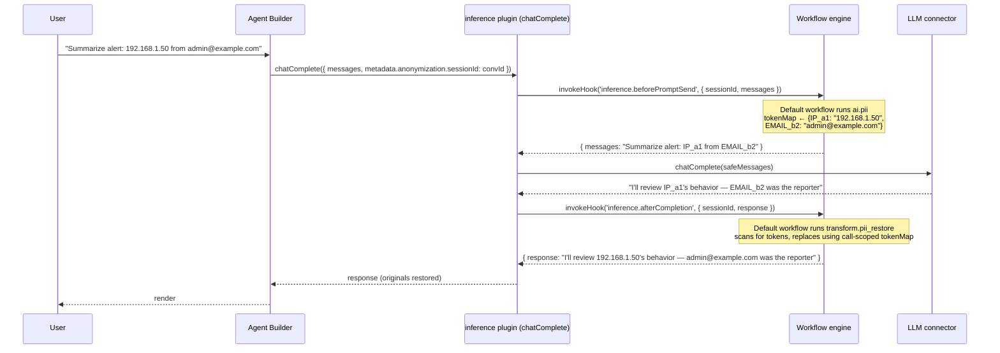
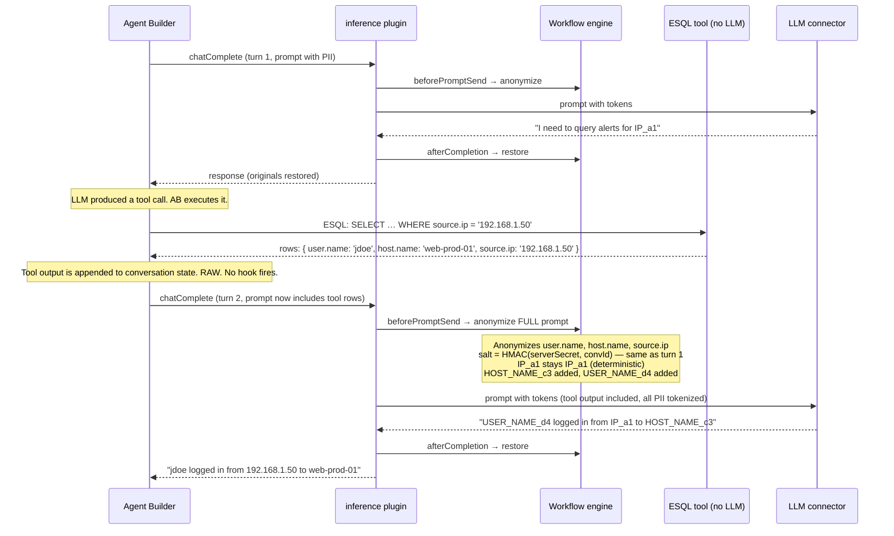

# RFC: Workflow-Driven LLM Anonymization at the Inference Layer

> **Status:** Draft
> **Date:** May 2026
> **Companion:** [`proposal.md`](./proposal.md) — workflow lifecycle hooks platform proposal
> **Supersedes:** the abandoned three-layer anonymization platform RFC

## 1. Summary

Anonymize what we send to a language model — nothing more, nothing less. Place a single pair of synchronous workflow lifecycle hooks at the **`inference` plugin's `chatComplete` boundary**, the one site every LLM call in Kibana must pass through. A `before` hook anonymizes the serialized prompt; an `after` hook restores originals in the response. A small in-memory session store, keyed by a caller-supplied conversation identifier, holds the deterministic HMAC-SHA256 token map for the lifetime of the conversation.

Two new step types — `ai.pii` and `transform.pii_restore` — make the anonymization itself author-customizable through the existing workflow YAML. A default workflow ships out of the box with the regex set the PM doc requires (IP, EMAIL, HOST_NAME, USER_NAME, custom). Agent Builder requires zero changes. The workflow engine gets one optional field on `registerTriggerDefinition` and one new method on `WorkflowsClient`. Every existing anonymization implementation in the repo is deprecated and replaced by this single integration point.

## 2. Goals & Non-goals

### Goals

- **G1.** Prevent any prompt text — user message, attached context, tool output — from reaching a model in raw form when anonymization is enabled.
- **G2.** Restore original values in the model response before it is rendered to the user, with consistent token correlation across multiple inferences in one conversation.
- **G3.** Achieve this with a workflow-driven, user-extensible mechanism (regex set is configurable in YAML, custom rules can be added) rather than hard-coded plumbing.
- **G4.** Add **one** integration point — the `chatComplete` boundary — that covers Agent Builder, Observability AI Assistant, Security AI, attack-discovery, and any future LLM consumer without per-consumer wiring.
- **G5.** Make Agent Builder a passive beneficiary: zero code changes, zero new contracts.
- **G6.** Replace every existing in-tree anonymization implementation with this one mechanism.

### Non-goals

- **N1.** Field-level allow/anonymize/deny. ESQL lineage gaps make this unworkable for tool outputs (ESQL operators like `EVAL`, `STATS`, `MV_*` produce derived columns whose lineage to source fields cannot be reconstructed). Documented in [`MEMORY`](#) and the PM doc; this RFC operates strictly at text level.
- **N2.** Persistent replacements. PM directive: transient state only. No system index, no encryption-at-rest, no cross-session correlation.
- **N3.** NER-based PII detection. Deferred to a phase-2 RFC; the regex set covers the structured-PII cases in scope today.
- **N4.** Cases / Dashboards lifecycle hook integrations. Those are covered by [`proposal.md`](./proposal.md); this RFC narrows to inference.
- **N5.** Guardrail-style policy denial (`ai.guardrail`, off-topic checks). Same hook platform, separate concern, separate workflow.
- **N6.** Reshaping or rewriting either the workflow engine or Agent Builder. Both gain additive surface area only.

## 3. Context & Prior Art

### 3.1 PM constraints

The PM milestone doc (`Anonymization P1 Milestone_ Bare-Bones LLM Data Protection.md`) sets three hard constraints inherited from prior team direction:

1. **LLM-only scope** — anonymize what we send to the model; everything else is a nice-to-have.
2. **Transient state** — no persistence; in-memory mapping between before/after callbacks.
3. **Tightly scoped integration** — originally framed as "Agent Builder only"; this RFC interprets that as "one integration site that covers all current and future LLM consumers" (the `inference` plugin), which is *more* scoped than per-consumer wiring.

The PM doc also names what is explicitly out of scope: field-level rules, NER, persistent replacements, encrypted storage, global anonymization profiles, legacy migration tooling.

### 3.2 ESQL lineage limitation → text-level not field-level

The abandoned three-layer RFC documented an irreducible problem: per-field Allow/Anonymize/Deny only works when you can trace which source field produced a given column. ESQL operators (`EVAL`, `STATS`, `MV_*`, renames, complex expressions) produce derived columns whose lineage is ambiguous or unrecoverable outside the ESQL planner. Because Agent Builder tools are defined in ESQL, any data flowing through tool outputs has typically been transformed beyond field-level traceability.

The fallback for unknown lineage is either deny (drop the value entirely) or over-anonymize (mask everything), both of which degrade usability. Achieving comprehensive field-level coverage would require either ESQL-native lineage support or a maintained lineage extractor — neither exists, neither is planned.

Operating at the **text/prompt level** sidesteps the lineage problem entirely: regex matches a value, replaces it with a token, and the anonymization is invariant to whatever transformations produced that text.

### 3.3 Inventory of existing anonymization implementations

Eight implementations exist in the repo today. All are deprecated by this RFC; reusable utilities are extracted, the rest is removed. The full table is in [§8 Deprecation & Migration](#8-deprecation--migration). Headlines:

| Location | What it does | Fate |
|---|---|---|
| `inference/server/chat_complete/anonymization/*` | Regex + NER detection, persistent replacements, AES-256-GCM encryption | Remove; extract regex executor |
| `anonymization/` plugin | Profiles, salt service, policy resolver, system index | Remove entirely |
| `kbn-elastic-assistant-common/impl/data_anonymization/*` | UUID-based field-level replacements | Remove |
| `elastic_assistant` `anonymizationFields`, `transformRawData` | Field-level rule plumbing on alerts | Remove |
| `AI:anonymizationSettings` UI setting | Legacy regex/NER rule storage | Remove (one-shot import) |
| `observability_ai_assistant/.../add_anonymization_data.ts` | Streaming deanon decorator coupled to old replacements | Remove |
| `legacy_ui_settings_migration.ts` | Migration from `AI:anonymizationSettings` to profiles | Remove |
| `kbn-ai-infra/anonymization-common/generate_token.ts` | HMAC-SHA256 deterministic tokenizer | **Keep & reuse** |

## 4. Architecture

### 4.1 Single hook point at `chatComplete`

Every LLM call from Kibana code goes through `inference.chatComplete` (or its streaming counterpart, `chat`). Agent Builder's research and answer agents both use `InferenceChatModel` from `@kbn/inference-langchain`, which delegates to `chatComplete`. Tools that call the LLM internally do the same. Observability AI Assistant, Security AI workflows, attack-discovery — all routed through `chatComplete`.

The following table documents the verified call path for each current consumer (verified against the codebase at the time of this RFC):

| Consumer | How it reaches `chatComplete` | Covered |
|---|---|---|
| Agent Builder (research + answer agents) | `InferenceChatModel` (`@kbn/inference-langchain`) → `client.chatComplete` | Yes |
| Observability AI Assistant | `plugins.inference.getClient()` → `inferenceClient.chatComplete()` directly | Yes |
| Attack Discovery | `inference.getClientWithoutRequest()` → `chatComplete` | Yes |
| SIEM Migrations | `inference.getChatModel()` → `InferenceChatModel` → `chatComplete` | Yes |
| Entity Analytics / Lead Generation | `inference.getChatModel()` → `InferenceChatModel` → `chatComplete` | Yes |
| AI Rule Creation (Detection Engine) | `inference.getClient()` → `chatComplete` | Yes |
| Automatic Import | `InferenceChatModel` → `chatComplete` | Yes |
| **Security AI Assistant (primary path)** | `inference.getChatModel()` → `InferenceChatModel` → `chatComplete` | **Yes** |
| **Security AI Assistant (legacy path)** | `ActionsClientChatOpenAI` / `ActionsClientChatBedrockConverse` / `ActionsClientChatVertexAI` → `actionsClient.execute()` directly | **No — bypasses inference plugin** |

> **Exception — Security AI legacy path.** The `elastic_assistant` plugin has a feature-flagged bypass (`inferenceChatModelDisabled`) that instantiates LangChain model classes directly against the actions connector, skipping the inference plugin entirely. When this flag is `true`, no `chatComplete` call is made and neither anonymization hook fires. The flag exists as a compatibility escape hatch from the migration to inference-routed models. Phase 3 of this RFC's migration (§8.3) must include removing this bypass path; until it is removed, Security AI sessions that hit the legacy path receive no anonymization. The Phase 1 implementation checklist must verify that `inferenceChatModelDisabled` is never `true` in production deployments, and Phase 3 deletes the flag and the three `ActionsClientChat*` model classes it selects.

The RFC places exactly two synchronous hooks around the connector call:

```
                                     ┌───────────────────────────────────┐
                                     │  inference plugin · chatComplete  │
                                     │                                   │
caller (AB graph node, OAS,    ──→   │   1. resolve options              │
attack-discovery, etc.)              │   2. invokeHook('beforePromptSend')│
                                     │   3. connector.chatComplete(…)    │
                                     │   4. invokeHook('afterCompletion')│
                                     │   5. return                       │
                                     └───────────────────────────────────┘
```

That single placement gives us:

- **G4 satisfied** — every consumer is covered without per-consumer wiring.
- **G5 satisfied** — Agent Builder code is untouched.
- **Tool output coverage by induction** — tools that don't call the LLM produce raw text → that text becomes part of the *next* `chatComplete`'s prompt → the `beforePromptSend` hook anonymizes the whole serialized prompt, including the tool output, before the connector sees it. There is no path from tool result to model that bypasses `chatComplete`.
- **Tools that call the LLM internally go through two anonymization cycles per user turn.** Some tools call `chatComplete` themselves (summarization, classification, LLM-assisted retrieval). Each such call gets its own `beforePromptSend` / `afterCompletion` pair — the tool's query is anonymized, the response is deanonymized, and the tool returns real values to Agent Builder. Agent Builder then incorporates those real values into the next parent `chatComplete` call, where the same PII is anonymized again. A single PII value therefore passes through the anonymization cycle twice in one user turn: once inside the tool's LLM call and once in the parent's follow-up prompt. This is correct behavior — HMAC determinism ensures `192.168.1.50` produces the same token `IP_a1b2c3` in both cycles — but it is a non-obvious consequence of the boundary placement that implementers should be aware of.

### 4.2 Trigger registrations on the `inference` plugin

Two triggers, registered during the inference plugin's `setup()`:

```typescript
// x-pack/platform/plugins/shared/inference/server/plugin.ts — setup()

import { z } from '@kbn/zod/v4';

workflowsExtensions.registerTriggerDefinition({
  id: 'inference.beforePromptSend',
  eventSchema: z.object({
    sessionId: z.string().describe('Caller-supplied conversation identifier'),
    system: z.string().optional(),
    messages: z.array(MessageSchema),
  }),
  sync: {
    outputSchema: z.object({
      system: z.string().optional(),
      messages: z.array(MessageSchema),
    }),
    maxTimeout: '10s',
    failurePolicy: 'closed',         // default — broken anonymization MUST NOT silently leak PII
    chained: true,                   // each workflow sees previous workflow's output (see §4.5)
  },
});

workflowsExtensions.registerTriggerDefinition({
  id: 'inference.afterCompletion',
  eventSchema: z.object({
    sessionId: z.string(),
    response: ResponseSchema,
  }),
  sync: {
    outputSchema: z.object({
      response: ResponseSchema,
    }),
    maxTimeout: '10s',
    failurePolicy: 'closed',         // default — failed restore surfaces an error, not raw tokens
    chained: true,
  },
});
```

Both triggers follow `proposal.md`'s shape exactly: an event schema for the input, a `sync` block with an output schema, a timeout, and a failure policy. The implicit-output rule from `proposal.md` §4.3 applies — when input and output schemas have the same shape, no `workflow.output` step is required.

### 4.3 Derived salt and call-scoped token map

The anonymization mechanism needs two things to function correctly across turns within a conversation:

1. **A deterministic salt** — so the same PII value always produces the same token, across turns and across Kibana nodes.
2. **A token map** — so `transform.pii_restore` can reverse tokens back to originals in the response.

Both are achieved without persistent state.

#### Derived salt

The HMAC salt is derived on demand from a stable server secret and the caller-supplied `sessionId`:

```typescript
function deriveSalt(sessionId: string, serverSecret: string): string {
  return createHmac('sha256', serverSecret).update(sessionId).digest('hex');
}
```

`serverSecret` is a Kibana keystore value (same category as `xpack.encryptedSavedObjects.encryptionKey` — stable across restarts, not rotated routinely). Because the function is pure, any Kibana node derives the same salt for the same `sessionId`. No storage, no TTL, no session affinity required, no distributed-state problem.

Cross-turn token consistency follows directly: `192.168.1.50` produces `IP_a1` in turn 1 and `IP_a1` in turn 5, even if the Kibana process restarted between turns, because the salt is always `HMAC(serverSecret, sessionId)`. This is a strict improvement over a session-store design, which would produce different token names after a session eviction.

#### Call-scoped token map

The token map lives only for the duration of a single `chatComplete` call. The inference plugin creates it before invoking `beforePromptSend`, passes it to both hook executions via a call-scoped context handle, and discards it when the call returns:

```typescript
// Inside chatComplete — simplified
const salt = deriveSalt(sessionId, serverSecret);
const tokenMap: TokenMap = new Map();

const hookCtx = createAnonymizationContext({ salt, tokenMap });

await invokeHook('inference.beforePromptSend', event, hookCtx);
// hookCtx.tokenMap now contains all matches from the full prompt scan

const response = await connector.chatComplete(anonymizedMessages);

await invokeHook('inference.afterCompletion', { ...event, response }, hookCtx);
// transform.pii_restore reads hookCtx.tokenMap to restore originals
```

`ai.pii` and `transform.pii_restore` access the context via a capability handle — the workflow YAML sees neither the salt nor the map. The token map is garbage-collected with the request; it is never written to disk, never shared across requests, and never visible to other concurrent calls.

#### Per-consumer threading expectations

`sessionId` is supplied by the caller through `ChatCompleteOptions.metadata.anonymization.sessionId`. Without it, the inference plugin generates a per-request UUID — anonymization works for that call, cross-turn token consistency is lost.

| Consumer | Stable identifier available | Action required |
|---|---|---|
| Agent Builder | `conversationId` (generated at chat-round entry, persisted with the conversation) | Map `conversationId → metadata.anonymization.sessionId` in the existing inference call site. **Verify in implementation** that AB threads this through `chatComplete` |
| Observability AI Assistant | Conversation saved object ID | Map saved-object ID → `sessionId`. **Verify** OAS uses a stable ID across turns |
| Security AI / attack-discovery | Typically single-shot batch operations | Per-call UUID is acceptable — cross-call consistency not needed. Document explicitly |
| New consumers | Must decide based on use case | Supply a stable ID if multi-turn correlation matters; omit otherwise |

**Migration of `replacementsId`**: the existing `metadata.anonymization.replacementsId` field was used by the persistent-replacements feature being deleted. In Phase 1, the inference plugin accepts both — `sessionId` if present, otherwise `replacementsId` as a fallback. By Phase 3 the `replacementsId` form is removed entirely.

### 4.4 New step types — `ai.pii` and `transform.pii_restore`

Both shipped server-side, registered via `workflows_extensions` (where built-ins like `data.set`, `if`, `foreach` already live). Both reuse existing utilities so the surface area is small.

#### `ai.pii`

Detects PII in input text and replaces matches with deterministic HMAC-SHA256 tokens. Writes matches to the call-scoped token map via the execution context handle.

```yaml
- name: anonymise
  type: ai.pii
  with:
    input: "{{ event.messages }}"
    entities:
      - IP
      - EMAIL
      - HOST_NAME
      - USER_NAME
    custom_patterns:
      - pattern: 'EMP_\d{6}'
        entity_class: EMPLOYEE_ID
    action: replace                 # 'replace' (default) | 'block'
```

Internally:

1. Iterate over the configured rules; run each regex against the serialized input.
2. For each match, look up the original in the call-scoped token map (return existing token if already seen in this call), else compute `generateToken(salt, entityClass, '', value)` from the derived salt and insert into the map.
3. Return the substituted text, longest-match-first to avoid partial overlaps (e.g., `192.168.1.50` before `192.168.1.5`).

Reused utilities:
- `generateToken()` from `@kbn/ai-infra/anonymization-common/generate_token.ts:33-56`.
- The regex executor and entity-class taxonomy currently inside `inference/server/chat_complete/anonymization/execute_regex_rule_task.ts:20-72`, extracted into a new shared package `@kbn/ai-infra/pii-detection` *before* the inference plugin's anonymization code is removed.

#### `transform.pii_restore`

Reverse pass — scans input text for tokens and restores originals from the call-scoped token map. No-ops if the map is empty.

```yaml
- name: deanonymise
  type: transform.pii_restore
  with:
    input: "{{ event.response }}"
```

Single regex against the token format `{ENTITY_CLASS}_{HEX}` (deterministic from `generateToken`'s output shape) plus a map lookup per match.

### 4.5 Default workflow shipped out of the box

Two YAML workflows ship in a small companion package (`@kbn/ai-infra/default-anonymization-workflows` — content-only, no plugin code). They subscribe to the two triggers and use the standard regex set from the PM doc:

```yaml
# Default before-prompt anonymization
version: '1'
name: Default LLM PII Anonymization
enabled: true
triggers:
  - type: inference.beforePromptSend

steps:
  - name: anonymise_system
    type: ai.pii
    if: "event.system != null"
    with:
      input: "{{ event.system }}"
      entities: [IP, EMAIL, HOST_NAME, USER_NAME]
      action: replace

  - name: anonymise_messages
    type: ai.pii
    with:
      input: "{{ event.messages }}"
      entities: [IP, EMAIL, HOST_NAME, USER_NAME]
      action: replace

  - name: emit
    type: workflow.output
    with:
      system: "{{ steps.anonymise_system.output.text ?? event.system }}"
      messages: "{{ steps.anonymise_messages.output.text }}"
```

```yaml
# Default after-completion de-anonymization
version: '1'
name: Default LLM PII De-anonymization
enabled: true
triggers:
  - type: inference.afterCompletion

steps:
  - name: deanonymise_response
    type: transform.pii_restore
    with:
      input: "{{ event.response }}"
```

**Both `event.system` and `event.messages` are anonymized.** System prompts can contain PII when callers embed user-configurable strings (space names, agent descriptions, tool definitions referencing customer URLs); leaving them unprocessed would defeat the feature. The before-hook input schema explicitly includes `system`, and the default workflow covers it. The `if:` clause skips the step when no system prompt is supplied.

Off by default. Admin enables it per-space (or per-agent in Agent Builder) via the same UI setting plumbing the existing `runBeforeAgentWorkflows` already uses — workflow IDs become a configurable list under a top-level `inference.anonymization.workflowIds` setting. Enterprise license gated, consistent with the legacy Assistant.

Admin can:
- Disable the default workflow.
- Clone it and add custom regex rules (e.g., internal employee IDs, account numbers).
- Author entirely different workflows that subscribe to the same triggers.

#### Multi-workflow ordering and the shared session store

`proposal.md` §5 specifies that multiple workflows on the same hook run **sequentially in priority order**, each receiving the **original event** as input, with outputs merged "last writer wins per field." That model works for guardrail-style workflows (independent assertions) but does **not** compose for anonymization, where each workflow modifies the same field (`messages` / `system`) and a naive last-writer-wins erases earlier substitutions.

This RFC pins down the semantics for the two anonymization triggers specifically: **sync hooks marked as `chained: true` in the trigger definition pass the *previous workflow's output* (not the original event) as the next workflow's input.** The trigger registrations in §4.2 set `chained: true`. This adds one optional field to the trigger registration API; it does not change `proposal.md`'s default merge model for other hooks.

Concretely:

```
invokeHook('inference.beforePromptSend', { messages, system, sessionId })
  ├── Workflow A (priority 1, custom org patterns) ──→ output { messages: A(messages), system: A(system) }
  ├── Workflow B (priority 2, default workflow)    ──→ input is A's output; produces B(A(messages))
  └── Final output: B(A(messages)), B(A(system))    sent to the LLM
```

The session token map is mutated incrementally by each `ai.pii` invocation across both workflows, so a value matched by workflow A and again by workflow B yields the same token (HMAC determinism + map idempotency).

**Recommended pattern**: keep anonymization in a single workflow and add entities/custom_patterns to it. Multi-workflow chaining is supported for the case where one team owns "core PII" and another owns "org-specific patterns," but adds operational complexity. The default ships as one workflow.

**Read-only auditing workflows** (e.g., a workflow that wants to *observe* what was anonymized without modifying anything) should subscribe to the async `inference.promptAnonymized` event — a separate event trigger to be added if the audit use case materializes. They must not subscribe to the sync hooks; subscribing read-only workflows to a chained sync hook is rejected at save time.

### 4.6 Streaming de-anonymization

`chatComplete` has a streaming sibling. The `afterCompletion` hook runs once on the assembled response in the non-streaming path, but for streams the de-anonymization needs to operate on each chunk while preserving correctness across two kinds of boundary:

1. **Token boundaries** — a single `IP_a1b2c3…` token can be split across chunks.
2. **Structural boundaries** — when the LLM streams a tool call, the call appears in the stream as a JSON delta (typically inside an `assistant.tool_calls[].function.arguments` field) that may span many chunks. Restoring tokens *inside* the tool call's argument JSON is the **correct** behavior — Agent Builder must execute the tool with real values, not tokens — but restoration must not flush a partial JSON delta that the consumer would attempt to parse mid-stream.

The inference plugin wraps the SSE/streamed response through a transform stream that:

1. Maintains a sliding buffer sized to the larger of:
   - `MAX_TOKEN_LENGTH` (entity prefix + 64 hex chars + safety margin, ~128 bytes), and
   - the current incomplete structural unit (open `function.arguments` delta) reported by the LLM connector's stream parser.
2. Emits any prefix of the buffer that cannot possibly contain (a) a partial token or (b) a partial structural unit.
3. On each emission, runs `transform.pii_restore` against the emit-able prefix using the call-scoped token map (captured in a closure when the stream is opened).
4. Flushes the remainder on stream end.

For SSE streams that interleave content deltas and tool-call deltas, the transform tracks delta type from the connector's parser and applies the buffering rule per-stream-channel. The hook itself runs once (the workflow does not see individual chunks); the buffering is an inference-plugin implementation detail. This keeps the workflow contract simple and avoids paying hook overhead per chunk.

**Implementation risk callout**: the connector-specific delta shapes (OpenAI, Anthropic, Bedrock, Gemini) differ. The streaming transform sits *above* the connector but needs the connector's stream parser to report structural boundaries. This is a real implementation cost in Phase 1; the Phase 1 spike should validate at least the OpenAI and Anthropic shapes before committing to the abstraction.

## 5. End-to-end flow

### 5.1 Single-cycle round



### 5.2 Multi-cycle round with a tool that doesn't call the LLM

This is where the "single hook covers tool outputs" property is most visible. The tool produces raw PII; the next inference cycle anonymizes it on its way to the model. No separate tool hook is required.



The key property: **tokens are stable across cycles** because the salt is derived deterministically from `HMAC(serverSecret, convId)` — the same value always produces the same token regardless of which Kibana node handles the request or how much time has elapsed between turns.

## 6. API surface — what changes, what doesn't

### 6.1 Workflow engine (additive)

| Change | Where | Surface |
|---|---|---|
| Optional `sync` block on trigger registration | `workflows_extensions/server/types.ts` | One new optional field on the trigger definition — backward compatible |
| `sync.chained` flag on trigger registration | same | One new optional sub-field — defaults to `false` (proposal.md merge model) |
| `WorkflowsClient.invokeHook(triggerId, payload)` | `kbn-workflows/server/types.ts` | One new method on the public client |
| Internal sync execution path | New file alongside the existing async machinery | Reuses `executeWorkflow({ waitForCompletion: true })` |
| Save-time validation: chained sync triggers reject read-only workflows | workflow editor / save handler | Small validation rule |

No engine rewrite. `emitEvent` continues to behave exactly as today. Triggers without a `sync` block remain async-only and reject `invokeHook` calls. The `chained` flag is a small addition isolated to sync execution.

### 6.2 Inference plugin (additive)

| Change | File |
|---|---|
| Register two triggers in `setup()` | `inference/server/plugin.ts` |
| Wrap `createChatCompleteApi` to call `invokeHook` before/after the connector, threading the call-scoped context | `inference/server/chat_complete/api.ts` |
| `deriveSalt(sessionId, serverSecret)` — pure function, no storage | `inference/server/anonymization/derive_salt.ts` |
| `AnonymizationContext` — call-scoped handle carrying `{ salt, tokenMap }`, passed to both hook executions | `inference/server/anonymization/context.ts` |
| Streaming transform that buffers across chunks, captures token map in closure | `inference/server/chat_complete/streaming_anonymizer.ts` |

### 6.3 Agent Builder (zero changes)

The chat-round path, graph nodes, hooks, prompt assembly, tool runner — none of it is modified by this RFC. Anonymization is invisible to Agent Builder; it just happens in the inference plugin.

(A separate, unrelated cleanup migrates `runBeforeAgentWorkflows` from its bespoke loop to the new generic `invokeHook` API. That cleanup is *not* anonymization-related and is called out only so reviewers don't conflate the two.)

### 6.4 New / reused packages

| Package | Status |
|---|---|
| `@kbn/ai-infra/anonymization-common` | **Keep** — `generateToken()` reused as-is |
| `@kbn/ai-infra/pii-detection` | **New** — extracted regex executor + entity-class taxonomy from inference plugin |
| `@kbn/ai-infra/default-anonymization-workflows` | **New** — content-only YAML library |
| `@kbn/anonymization-common` (current) | **Remove** after default workflow ships |

## 7. Key design decisions

For each decision below: the recommendation, a one-paragraph rationale, and an alternatives table.

### 7.1 Hook placement: `chatComplete` boundary

**Recommended:** A single hook pair at `inference.chatComplete`.

**Rationale:** Every model-bound text in Kibana — agent prompts, tool outputs that ride along in the next prompt, observability summaries, attack-discovery prompts — passes through this one boundary. Hooking here gives complete coverage by induction (tool outputs become part of the next prompt and are anonymized at that point) and zero per-consumer wiring. The PM doc's framing of "before LLM call / after LLM call" maps onto this boundary verbatim.

| Option | Coverage | Wiring | Risk |
|---|---|---|---|
| **`chatComplete` boundary (recommended)** | Full | One site | Low |
| Per-consumer (AB graph nodes + `afterToolCall` hook + Observability AI + Security AI + …) | Full only if every site is wired | N sites | High — easy to miss a path; new consumers must remember to wire |
| Connector layer (below inference plugin) | Full | One site | Medium — connectors are vendor-specific; harder to expose a uniform message shape |

### 7.2 Token map ownership: call-scoped context with derived salt

**Recommended:** The inference plugin derives the HMAC salt from `HMAC(serverSecret, sessionId)` on each call and holds the token map in a call-scoped `AnonymizationContext` that is threaded between the two hook invocations as an internal implementation detail. Workflow steps access it via an execution-context capability handle; the YAML never references the salt or map directly.

**Rationale:** A derived salt is fully deterministic — the same `sessionId` always produces the same salt on any node, so cross-turn token consistency holds without any persistent state. The call-scoped token map avoids in-memory session management (no TTL, no eviction, no LRU, no distributed-state problem in multi-node Kibana deployments) while keeping the workflow YAML as clean as the session-store approach. The inference plugin remains stateless, which is appropriate for a platform infrastructure component.

| Option | Pros | Cons |
|---|---|---|
| **Derived salt + call-scoped context (recommended)** | Stateless; works across nodes; no TTL/eviction; clean YAML; deterministic cross-turn consistency | HMAC recomputed per match per turn (negligible cost); requires `serverSecret` in inference plugin |
| Session-store (`SessionStore` keyed by `sessionId`) | Salt cached after first call | Node-local in-memory state; breaks in multi-node clusters without sticky sessions; requires TTL, eviction, and `maxSessions` cap in a platform plugin that should be stateless |
| Caller-passed `tokenMap` in hook payload (proposal.md Alt A) | Pure functional; no side-channel | Every consumer must thread the map; cross-turn consistency requires callers to hold and forward the map themselves |
| Engine-side ephemeral state (proposal.md Alt B) | Engine owns it | New storage subsystem; key-collision risk; cleanup problem on after-hook failure; opaque in execution logs |

### 7.3 Sync hook registration: extend existing API

**Recommended:** Add an optional `sync` block to `registerTriggerDefinition`.

**Rationale:** Workflow authors subscribe the same way to async events and sync hooks today; differentiating at registration time (rather than splitting into `registerTriggerDefinition` vs `registerHookDefinition`) preserves that uniformity. The change is one optional field — zero impact on every async trigger registered today.

| Option | Pros | Cons |
|---|---|---|
| **Optional `sync` block (recommended)** | Single API; backward compatible; matches `proposal.md` | Slightly more discriminated-union complexity in the registry type |
| New `registerHookDefinition()` | Visually clearer separation | Two APIs; two registries; subscribers need to know which is which |

### 7.4 Default workflow: shipped baked-in (off by default)

**Recommended:** Ship two default YAML workflows; admin enables per-space or per-agent.

**Rationale:** Out-of-box safety with admin opt-in. The PM doc requires a small fixed regex set; shipping it as a workflow makes it the same author-surface as everything else (admins can clone/override/extend without touching code). Off-by-default protects existing deployments from unexpected behavior changes.

| Option | Pros | Cons |
|---|---|---|
| **Shipped baked-in, off by default (recommended)** | One-toggle activation; consistent author surface | Slightly more shipped content |
| Admin-must-author | Engine stays content-free | Anonymization is off until someone wires it; bad default for security |
| Shipped on by default | Strongest default | Behavior change for deployments that don't expect it |

### 7.5 Step type ownership: shared `workflows_extensions` package

**Recommended:** Register `ai.pii` and `transform.pii_restore` as built-ins in `workflows_extensions`, alongside `data.set`, `if`, `foreach`.

**Rationale:** The steps are general-purpose (any workflow author may want them), and the `workflows_extensions` plugin is exactly where shared step types already live. Making them inference-private would block reuse from non-inference contexts (e.g., a future log-redaction workflow that doesn't touch the LLM at all).

| Option | Pros | Cons |
|---|---|---|
| **Shared in `workflows_extensions` (recommended)** | Reusable; consistent with existing built-ins | Slightly broader public surface |
| Inference-plugin-private | Tighter scoping | Couples a generic capability to one consumer |

### 7.6 Failure-mode default: fail-closed

**Recommended:** Default `failureMode: 'block'` (fail-closed). Admin can opt into `'allow_unsafe'` (fail-open) per space.

**Rationale:** A broken anonymization workflow under fail-open silently sends raw PII to the model with no caller-side signal, no UI badge, no error — exactly the behavior the feature exists to prevent. PII leaks must not happen unnoticed. Fail-closed surfaces the failure to the user ("Anonymization is currently unavailable; the request was rejected") and lets the admin investigate. Operators who explicitly need service continuity over safety can opt in; no one gets the unsafe default by accident.

| Option | Pros | Cons |
|---|---|---|
| **Fail-closed default (recommended)** | No silent leaks; admin sees the failure; clear signal to investigate | Service interruption when a regex workflow is misconfigured |
| Fail-open default (proposal.md original) | Service continuity | Silent PII leak; defeats the feature's purpose; no caller-side signal |
| Hard fail-closed (no opt-in) | Strongest safety | Some deployments need to keep chat working during anonymization outages; removing the option creates pressure to disable anonymization entirely |

The opt-in (`'allow_unsafe'`) is named deliberately so it appears in audit logs as such; admins cannot enable it without a setting name that calls out the risk.

## 8. Deprecation & migration

### 8.1 What goes away

| Existing | Status | Reusable parts → moved to |
|---|---|---|
| `x-pack/platform/plugins/shared/inference/server/chat_complete/anonymization/*` | **Remove** | Extract regex executor + entity-class enum → `@kbn/ai-infra/pii-detection`; drop `prepare_anonymization`, `replacements_repository`, encryption layer, NER worker |
| `x-pack/platform/plugins/shared/anonymization/` (profiles, salt, policy) | **Remove entirely** | None |
| `x-pack/platform/packages/shared/kbn-elastic-assistant-common/impl/data_anonymization/*` | **Remove** | None |
| `elastic_assistant` field-level rule plumbing (`anonymizationFields`, `transformRawData`) | **Remove** | None |
| `AI:anonymizationSettings` UI setting | **Remove** | One-shot import: regex rules land in default workflow's pattern list |
| `observability_ai_assistant/.../add_anonymization_data.ts` | **Remove** | None |
| `legacy_ui_settings_migration.ts` | **Remove** | One-shot UI-setting import preserved separately |

### 8.2 What we keep / extract

| Kept | Reason |
|---|---|
| `@kbn/ai-infra/anonymization-common/generate_token.ts` | HMAC-SHA256 deterministic tokenizer — see signature change below |
| `@kbn/ai-infra/anonymization-common/ecs_entity_class_suggestions.ts` | Entity-class taxonomy + ECS field mappings (used by the default workflow's regex set) |
| Regex executor (extracted from `execute_regex_rule_task.ts`) | Position-tracked match logic — moved to new `@kbn/ai-infra/pii-detection` package, used by `ai.pii` step |

**`generateToken` signature change**: the current signature takes a `field` parameter (`generateToken(secret, entityClass, field, value, hashLength?)`) that was relevant only for field-level anonymization. With field-level deprecated (§N1), `field` is removed from the public signature: `generateToken(secret, entityClass, value, hashLength?)`. The HMAC input remains length-prefixed for delimiter safety. This is a breaking change for the deprecated callers (`prepare_anonymization`, `transformRawData`); since those are also being deleted, no third-party caller is affected.

### 8.2.1 `AI:anonymizationSettings` import

The legacy UI setting carries two rule shapes:

- **Regex rules** (`{ type: "RegExp", pattern, entityClass, enabled }`) — converted directly into entries in the default workflow's `custom_patterns` list under each `ai.pii` step. Disabled rules are skipped. The conversion is one-shot at first read after upgrade and produces an audit log entry per imported rule.
- **NER rules** (`{ type: "NER", modelId, allowedEntityClasses?, … }`) — **dropped** with a deprecation warning. Phase 2 (NER support) is not in this RFC's scope; admins who depended on NER rules see a clear log line and a UI banner pointing to the workflow editor and to the NER-tracking issue. Their existing rules are preserved in the legacy setting until manually removed, so a future NER RFC can re-import them.

The import is implemented as a one-shot migration in the inference plugin's startup, gated on the presence of `AI:anonymizationSettings` and idempotent (re-running is a no-op once the default workflow has been customized).

### 8.3 Migration phases

**Phase 1 — Land platform** (additive, dark)
- Workflow engine: optional `sync` block + `invokeHook`.
- Inference plugin: triggers + `deriveSalt` + `AnonymizationContext` + streaming transform; behind a feature flag, default off.
- New `ai.pii`, `transform.pii_restore` step types.
- Extract regex executor into `@kbn/ai-infra/pii-detection`.
No user-visible change; the existing inference-plugin anonymization continues to run.

**Phase 2 — Ship default workflow** (license-gated, admin opt-in)
- Default workflows shipped via `@kbn/ai-infra/default-anonymization-workflows`.
- New UI setting for `inference.anonymization.workflowIds`.
- One-shot import: `AI:anonymizationSettings` → patterns appended to default workflow's custom rules on first read.
- Documentation, observability dashboard.

**Phase 3 — Remove deprecated code**
- Delete `inference/server/chat_complete/anonymization/*` (after extraction lands).
- Delete `anonymization/` plugin in full.
- Delete `kbn-elastic-assistant-common/impl/data_anonymization/*`.
- Delete `elastic_assistant` field-level plumbing.
- Delete `observability_ai_assistant` deanon decorator.
- **Delete `elastic_assistant` legacy LLM path**: remove `inferenceChatModelDisabled` flag, `ActionsClientChatOpenAI`, `ActionsClientChatBedrockConverse`, `ActionsClientChatVertexAI`, and the `getLlmClass()` selector. All Security AI paths must route through `InferenceChatModel` before anonymization can be declared complete for that consumer.
- Coordinate timing with the Elastic Assistant retirement schedule.

The RFC itself ships **no code changes**; the phases above are the implementation plan, sequenced so that no version of `main` ever ships without working anonymization.

## 9. Guardrails

Inherited from `proposal.md` §"Lifecycle Hook Guardrails", with one important deviation: **failure policy defaults to `'closed'`** for anonymization. A broken anonymization workflow must not silently send raw PII to the model; the inference call is rejected and the caller surfaces an error.

| Guardrail | Setting |
|---|---|
| Hard timeout | 10s trigger, 30s platform cap |
| Failure policy (default) | `'closed'` — broken or timed-out anonymization workflow rejects the inference call. The caller (e.g., AB) surfaces an error to the user explaining anonymization is currently unavailable |
| Failure policy (admin opt-in) | `inference.anonymization.failureMode: 'allow_unsafe'` — the admin explicitly accepts that a broken workflow will pass raw prompts to the model. Logged as a warning each time. Not the default; deployments that want service continuity over safety must opt in |
| Token-cap exceeded | When the call-scoped token map for a single `chatComplete` call exceeds the configured cap (default 10 000 unique PII values) and `ai.pii` would need to insert a *new* token, the step returns failure with `reason: 'token_cap_exceeded'`. Existing tokens in that call's map still resolve correctly. With `failureMode: 'block'` (default) the inference call is rejected; with `allow_unsafe`, the call proceeds and only already-seen values are anonymized. Admin can raise the cap via `inference.anonymization.maxTokensPerCall` |
| Sync chain depth | ≤ 2 (existing infra, tighter limit for hooks) |
| Concurrency cap | 5 workflows per hook invocation, sequential |
| Save-time validation | Reject `wait`, `workflow.executeAsync`, `foreach > 100`, > 20 steps in hook workflows |
| Step output size | Existing engine limits inherited |
| Circuit breaker | **Phase-2 enhancement** — auto-suspend workflows that fail repeatedly; not in v1 |
| Admin kill switch | `inference.anonymization.enabled: false` global override — when off, no triggers fire and `chatComplete` proceeds without anonymization (this is a deliberate "feature is off" mode, not a silent-leak mode) |

### Failure-mode semantics in detail

| Hook | Workflow result | `failureMode: 'block'` (default) | `failureMode: 'allow_unsafe'` |
|---|---|---|---|
| `beforePromptSend` | success | Use anonymized prompt | Use anonymized prompt |
| `beforePromptSend` | failed / timeout | **Reject `chatComplete`** with `InferenceAnonymizationUnavailableError` | Log warn, send raw prompt to model |
| `afterCompletion` | success | Return restored response | Return restored response |
| `afterCompletion` | failed / timeout | **Reject `chatComplete`** with the same error class — caller does not see tokens | Log warn, return raw tokenized response (caller may show tokens or error to user) |

The default is fail-closed because the alternative is a silent PII leak with no caller-side signal. Admins who explicitly need service continuity can opt into `allow_unsafe` per-space. Both modes emit metrics (`anonymization.workflow.failure.count`) so dashboards can alert.

Streaming-specific: the buffering described in §4.6 is bounded (`MAX_TOKEN_LENGTH ≈ 128 bytes`) and adds a single-digit-millisecond latency floor; the regex-replace pass dominates. If the `afterCompletion` workflow fails mid-stream under `'block'`, the stream is aborted with the standard error class — partial chunks already emitted are unavoidable but those have already been de-anonymized by the streaming transform.

## 10. Open questions

- **Q1.** *Resolved in §4.3*. `metadata.anonymization.sessionId` becomes the canonical field. `replacementsId` accepted as fallback in Phase 1, removed by Phase 3.
- **Q2.** Where does the "default workflow" YAML actually live? Options: a content-only package (`@kbn/ai-infra/default-anonymization-workflows`), an asset bundled in the inference plugin, or a saved object seeded on startup. Saved object is consistent with how user-authored workflows live; package is simplest. RFC currently recommends package; saved-object seeding is a stretch consideration if admins want to edit the default in-place via the workflow UI without overriding it.
- **Q3.** Per-agent vs per-space scope of `inference.anonymization.workflowIds` — Agent Builder needs both (default for the space, override per agent). Does the inference plugin implement that resolution, or does AB pass the resolved list in `metadata.anonymization`? Current proposal: inference plugin resolves from the space-level UI setting; AB optionally overrides via `metadata.anonymization.workflowIds`.
- **Q4.** Streaming + multiple workflows on the same trigger under `chained: true` — the streaming transform is applied to the final merged response. If two chained workflows produce different token-restoration logic, the second's output is what's streamed. Recommendation: hold; the realistic use case is one PII workflow + optional read-only audit workflows (which don't subscribe to sync triggers anyway).
- **Q5.** Custom-pattern UX surface — does this RFC need to specify the admin UI for managing custom regex rules, or does that ride along with the workflow-authoring UI that already exists? Recommendation: ride along — adding/editing custom rules means cloning the default workflow and editing its `custom_patterns` field.
- **Q6.** **`sessionId` threading audit per consumer** (introduced in §4.3). Phase 1 implementation work must include a verification pass:
  - **AB**: confirm `conversationId` is threaded into `ChatCompleteOptions.metadata.anonymization.sessionId` from every chat-round inference call site (research agent, answer agent, any tool that calls the LLM internally).
  - **Observability AI Assistant**: confirm conversation saved-object ID is threaded the same way; if OAS allocates per-call IDs today, decide whether to thread the saved-object ID or to accept lost cross-turn correlation as the OAS migration cost.
  - **Security AI / attack-discovery / future consumers**: per-call UUID is acceptable but document explicitly so reviewers don't assume cross-call consistency.
  - The Phase 1 PR introducing the inference-plugin hook must include this audit as a checklist item; the RFC can't pre-resolve it because it requires reading current inference call sites that may change before implementation.
- **Q7.** Failure-mode default at the granularity level. The RFC sets `failureMode: 'block'` globally per space. Should agents/consumers be allowed to override it per call (e.g., a trusted internal pipeline that can tolerate temporary regex outage)? Recommendation: no — keep the default at the admin-policy layer, not the per-call layer, so individual consumers cannot weaken the security posture.
- **Q8.** Token-cap monitoring. Beyond the `anonymization.workflow.failure.count` metric in §9, do we need per-call cap-utilization metrics for early-warning? Recommendation: yes — surface `anonymization.call.tokens.count` histogram so admins can size the cap correctly. The per-call cap is far less likely to be hit than a per-session cap was (it requires a single prompt to contain more than 10 000 unique PII values), but the metric is still useful for sizing. Implementation detail, not a design question.

## 11. Success criteria

Restated from the PM doc, scoped to this RFC:

1. An admin can enable anonymization for an agent (or for an entire space) and configure which PII patterns are detected.
2. An analyst can ask "Summarize this alert" and the LLM never sees raw IPs, emails, hostnames, or usernames that match configured patterns — verifiable in workflow execution traces and connector logs. Both `system` prompts and `messages` are covered.
3. The analyst sees real values in the chat response (de-anonymized in the response stream/blob).
4. Deterministic tokens preserve entity correlation: the same value yields the same token across every `chatComplete` call that shares a `sessionId`, on any Kibana node, across restarts. Token determinism derives from `HMAC(serverSecret, sessionId)` — no stored state required.
5. No data persisted — the token map exists only for the duration of a single `chatComplete` call and is garbage-collected with the request. There is no session store, no TTL, and no eviction logic.
6. **Fail-closed by default**: when anonymization is enabled and a regex workflow fails, no raw prompt is sent to the model. The user sees a clear "Anonymization unavailable" error; admins see a metric and warn log. Silent leaks under default settings are not possible. The opt-in `failureMode: 'allow_unsafe'` is logged distinctly so audits can detect it.
7. **Token-cap exhaustion is loud, not silent**: when a single `chatComplete` call's prompt contains more than `maxTokensPerCall` unique PII values, new insertions produce a step failure that flows through `failureMode`. With the default, the call is rejected. The per-call cap is much harder to hit than a per-session cap — it requires a single prompt to contain more than 10 000 distinct PII values.
8. Enterprise license required for the feature to be enabled.
9. Works in air-gapped deployments — no external service dependency; HMAC and regex are local.
10. Regex scanning adds < 100 ms latency to prompt processing for the default rule set.
11. Every consumer of the inference plugin benefits without modification, **subject to the Phase 1 sessionId audit (Q6)** — Observability AI Assistant, Security AI, attack-discovery, Agent Builder all anonymize the same way through the same hook. Multi-turn correlation requires the consumer to thread a stable `sessionId`.
12. Every existing in-tree anonymization implementation listed in §8.1 is removed by the end of Phase 3.

## Appendix A — Surface area summary

A reviewer should be able to skim this table and conclude "this is small."

| Component | Net change |
|---|---|
| Workflow engine | +1 optional `sync` field on `registerTriggerDefinition` (with `chained` sub-field); +1 method (`invokeHook`) on `WorkflowsClient`; save-time validation rule for chained sync triggers |
| Inference plugin | +2 trigger registrations; wrap `chatComplete` body to call `invokeHook` twice; +1 `deriveSalt` pure function; +1 `AnonymizationContext` call-scoped handle; +1 streaming transform (token-boundary + structural-boundary aware); +3 admin settings (`enabled`, `failureMode`, `maxTokensPerCall`); **−** all of `chat_complete/anonymization/*` (after extraction); **no persistent state added** |
| New shared step types | `ai.pii`, `transform.pii_restore` (in `workflows_extensions`) |
| New shared package | `@kbn/ai-infra/pii-detection` (extracted regex executor + entity-class taxonomy) |
| New content package | `@kbn/ai-infra/default-anonymization-workflows` (two YAML files) |
| `generateToken` signature | `field` parameter removed (only used by deprecated callers being deleted) |
| Agent Builder | **0 changes** to chat-round / inference call sites; Phase 1 audit must verify `conversationId` → `sessionId` threading |
| Observability AI Assistant | Phase 1 audit; threading change if needed |
| Security AI / attack-discovery | Primary path via `InferenceChatModel` → covered. **Legacy path (`inferenceChatModelDisabled`)** bypasses inference plugin — must be removed in Phase 3 (see §4.1). Per-request UUID acceptable for cross-turn correlation; documented in Q6 |
| `anonymization` plugin | Removed |
| `elastic_assistant` field-level anonymization | Removed |
| `observability_ai_assistant` deanon decorator | Removed |
| `kbn-elastic-assistant-common/data_anonymization` | Removed |
| `AI:anonymizationSettings` | Removed via one-shot import (regex rules → default workflow `custom_patterns`; NER rules dropped with deprecation warning) |

## Appendix B — Glossary

- **Lifecycle hook** — synchronous, blocking workflow execution at a named "before" or "after" point. Distinguished from async events (`emitEvent`) by the `sync` block on the trigger definition.
- **`invokeHook(triggerId, payload)`** — new method on `WorkflowsClient`, returns `Promise<HookResult>`. Sync sibling of `emitEvent`.
- **`HookResult`** — `{ status, output, error? }`. `output` matches the trigger's declared `outputSchema`.
- **Session** — a logical conversation identified by `sessionId`. Used only as input to `deriveSalt`; the inference plugin holds no per-session state.
- **Derived salt** — `HMAC(serverSecret, sessionId)`. Pure function; same inputs always produce the same salt on any node. The salt is what makes tokens deterministic across turns.
- **`AnonymizationContext`** — call-scoped object holding `{ salt, tokenMap }`, created at the start of each `chatComplete` call and discarded when the call returns. Threaded between `beforePromptSend` and `afterCompletion` as an internal implementation detail; never exposed in workflow YAML.
- **Token** — a deterministic HMAC-SHA256 string of the form `{ENTITY_CLASS}_{HEX}` substituted for a PII value.
- **Token map** — the `Map<token, { original, entityClass }>` inside `AnonymizationContext`. Exists only for the duration of one `chatComplete` call.
- **`failurePolicy: 'open' | 'closed'`** — workflow failure causes the caller to proceed (`open`) or to surface an error (`closed`). Anonymization defaults to `'closed'`; admin can opt into `'open'` via `failureMode: 'allow_unsafe'`.
